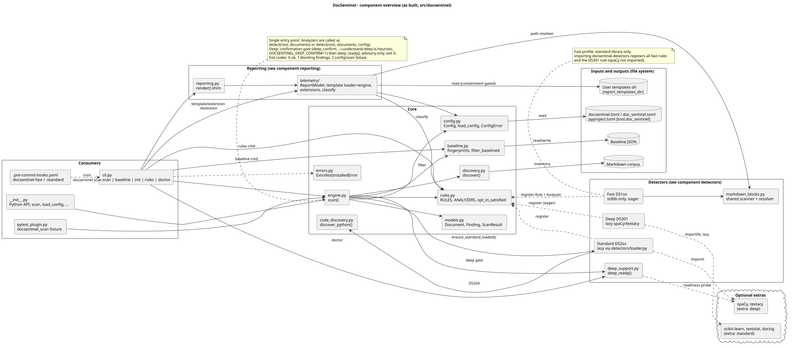
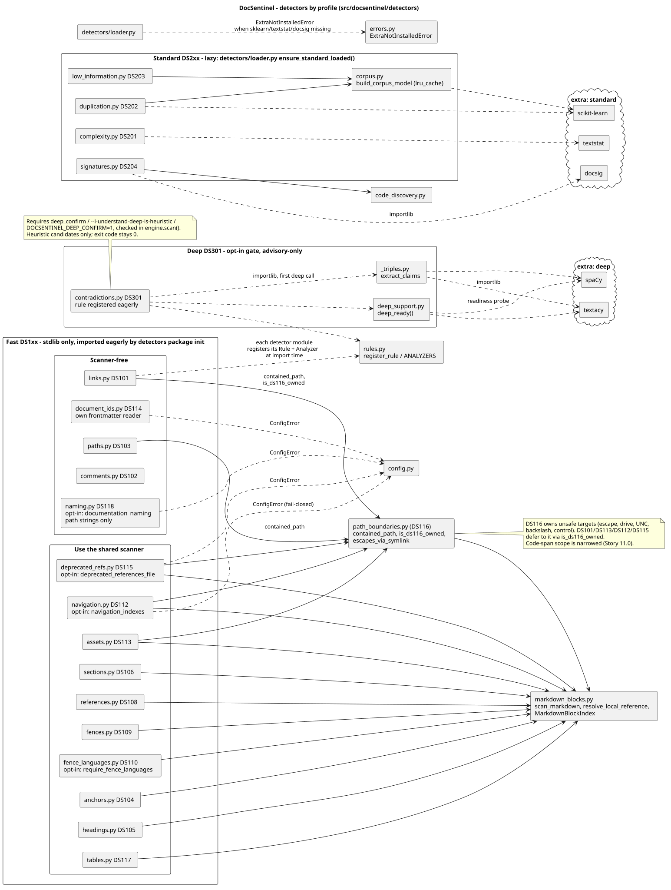
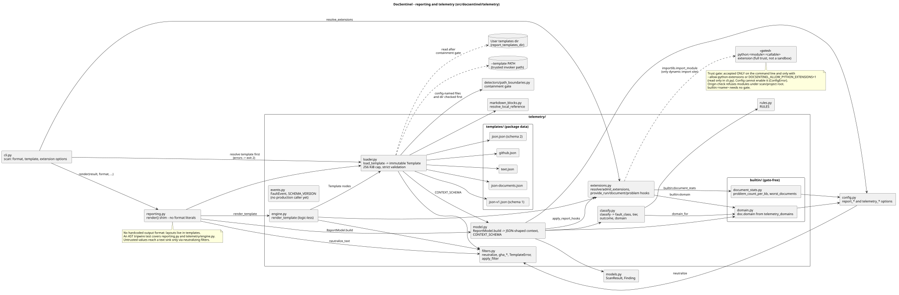

# Diagrams

Diagrams of the as-built DocSentinel package (`src/docsentinel/`), grouped by
diagram kind, one subdirectory per diagram. Each `.puml` source sits beside its
rendered `.svg` and `.png`. Re-render from the repository root with
`python .claude/skills/plantuml/scripts/convert_puml.py <path>.puml --format svg`
(repeat with `--format png`).

## Component diagrams (`component/`)

### Overview



### Detectors by profile



### Reporting and telemetry



## Layout

```text
docs/diagrams/
├── README.md
└── component/
    ├── overview/    component-overview.{puml,svg,png}
    ├── detectors/   component-detectors.{puml,svg,png}
    └── reporting/   component-reporting.{puml,svg,png}
```

New diagram kinds (sequence, state, deployment, …) get a sibling directory
next to `component/`, with one subdirectory per diagram.
